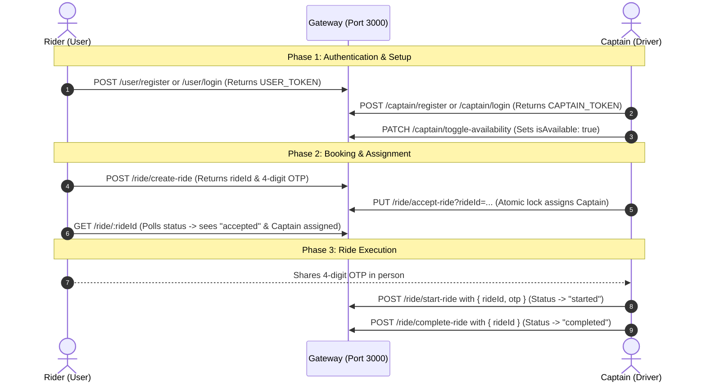

Here is the complete step-by-step lifecycle flow, sample credentials, and ready-to-use requests so you can test everything manually in **Postman**, **Thunder Client**, or **cURL**.

---

## 1. The Core Lifecycle Flow



---

## 2. Sample Credentials to Use

Use these credentials when testing:

| Role | Email | Password | Extra Details |
| :--- | :--- | :--- | :--- |
| **Rider (User)** | `rider@example.com` | `password123` | Name: `John Rider`, Phone: `9876543210` |
| **Captain (Driver)** | `captain@example.com` | `captainpass123` | Name: `Captain Alex`, Plate: `DL-01-AB-1234` |

---

## 3. Step-by-Step Manual Testing Guide

All requests are sent through the Gateway at **`http://localhost:3000`**.

> **Note on Authentication:**
> When you login/register, the response returns a `token`. In Postman / Thunder Client, pass it in the Headers:
> `Authorization: Bearer <YOUR_TOKEN>` (or via the cookies automatically set by the server).

---

### Step 1: Register or Login Rider
- **Endpoint:** `POST http://localhost:3000/user/register`  
*(or `POST http://localhost:3000/user/login`)*
- **Body (JSON):**
```json
{
  "name": "John Rider",
  "email": "rider@example.com",
  "password": "password123",
  "phone": "9876543210"
}
```
- **Response:** You will get a `token` and `user._id`.
- **Action:** Copy the `token` (this is your `USER_TOKEN`).

---

### Step 2: Register or Login Captain
- **Endpoint:** `POST http://localhost:3000/captain/register`  
*(or `POST http://localhost:3000/captain/login`)*
- **Body (JSON):**
```json
{
  "name": "Captain Alex",
  "email": "captain@example.com",
  "password": "captainpass123",
  "phone": "9123456780",
  "vehicle": {
    "plate": "DL-01-AB-1234",
    "vehicleType": "car"
  }
}
```
- **Response:** You will get a `token` and `captain._id`.
- **Action:** Copy the `token` (this is your `CAPTAIN_TOKEN`).

---

### Step 3: Captain Goes Online
- **Endpoint:** `PATCH http://localhost:3000/captain/toggle-availability`
- **Header:** `Authorization: Bearer <CAPTAIN_TOKEN>`
- **Response:**
```json
{
  "_id": "...",
  "name": "Captain Alex",
  "isAvailable": true
}
```

---

### Step 4: Rider Books a Ride
- **Endpoint:** `POST http://localhost:3000/ride/create-ride`
- **Header:** `Authorization: Bearer <USER_TOKEN>`
- **Body (JSON):**
```json
{
  "pickup": "Connaught Place, New Delhi",
  "destination": "IGI Airport Terminal 3",
  "fare": 350
}
```
- **Response:**
```json
{
  "_id": "6addefa5af2b985a95898b50",
  "user": "6addefa4689b914adf34de93",
  "captain": null,
  "pickup": "Connaught Place, New Delhi",
  "destination": "IGI Airport Terminal 3",
  "fare": 350,
  "otp": "4821",
  "status": "requested",
  "createdAt": "..."
}
```
- **Action:** Note down the **`_id`** (e.g. `6addefa5af2b985a95898b50`) and the 4-digit **`otp`** (e.g. `4821`).

---

### Step 5: Captain Accepts the Ride
- **Endpoint:** `PUT http://localhost:3000/ride/accept-ride?rideId=6addefa5af2b985a95898b50`
- **Header:** `Authorization: Bearer <CAPTAIN_TOKEN>`
- **Response:**
```json
{
  "_id": "6addefa5af2b985a95898b50",
  "status": "accepted",
  "captain": "6addefa59c6f7733708b5e13"
}
```
*(If you hit Send a second time, you will receive `400 Ride not found or already accepted by another captain`, proving the concurrency guard works!)*

---

### Step 6: Rider Checks Ride Status (Polling)
- **Endpoint:** `GET http://localhost:3000/ride/6addefa5af2b985a95898b50`
- **Header:** `Authorization: Bearer <USER_TOKEN>`
- **Response:** Shows `status: "accepted"` and the assigned `captain` ID.

---

### Step 7: Captain Starts the Ride (With OTP)
When captain reaches the pickup location, the rider shares the 4-digit OTP.
- **Endpoint:** `POST http://localhost:3000/ride/start-ride`
- **Header:** `Authorization: Bearer <CAPTAIN_TOKEN>`
- **Body (JSON):**
```json
{
  "rideId": "6addefa5af2b985a95898b50",
  "otp": "4821"
}
```
- **Response:**
```json
{
  "message": "Ride started successfully",
  "ride": {
    "_id": "6addefa5af2b985a95898b50",
    "status": "started"
  }
}
```
*(If you put the wrong OTP like `"0000"`, it will return `400 Invalid OTP`)*

---

### Step 8: Captain Completes the Ride
Once arrived at destination:
- **Endpoint:** `POST http://localhost:3000/ride/complete-ride`
- **Header:** `Authorization: Bearer <CAPTAIN_TOKEN>`
- **Body (JSON):**
```json
{
  "rideId": "6addefa5af2b985a95898b50"
}
```
- **Response:**
```json
{
  "message": "Ride completed successfully",
  "ride": {
    "_id": "6addefa5af2b985a95898b50",
    "status": "completed"
  }
}
```

---

### Step 9: Logout
- **Endpoint:** `GET http://localhost:3000/user/logout` (or `/captain/logout`)
- **Header:** `Authorization: Bearer <TOKEN>`
- **Response:** `{"message": "User logged out successfully"}`
- *(Subsequent requests using this token will be rejected with `401 Token has been revoked`)*